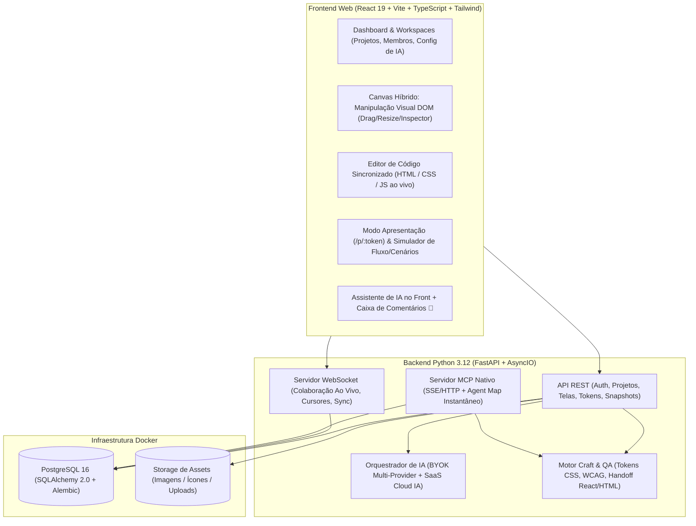
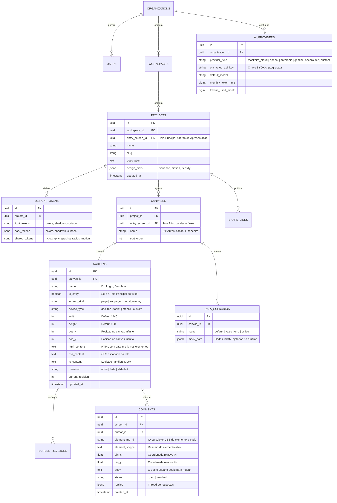

# 🦅 Mockbird v2 — Arquitetura & Plano Mestre (Clean-Room SaaS)

> **Licença Inicial:** MIT (Open Source, pronto para Self-Hosted e evolução futura para Cloud SaaS com assinatura de IA)  
> **Stack Oficial:** Backend em **Python 3.12 (FastAPI + SQLAlchemy 2.0 + PostgreSQL 16 + MCP)** · Frontend em **React 19 + Vite + TypeScript + Tailwind CSS**  
> **Nota:** colaboração em tempo real via WebSocket, storage de assets e planos/quotas de IA SaaS são **roadmap** — ver "Status real" no fim deste documento.
> **Filosofia:** Zero código copiado do sistema antigo. Resgatamos apenas as melhores ideias do Mockbird original em uma arquitetura limpa, sem arquivos locais e sem burocracias que travem o fluxo.

---

## 🎯 1. A Essência do Produto (Por que o Mockbird v2 existe?)

O Mockbird nasceu de uma necessidade real e prática:
1. **Apresentar rápido para o CEO / Stakeholders por um Link Web**: Criar o frontend funcional de um sistema real em minutos com ajuda da IA e mandar um link de **Modo Apresentação** onde o sistema parece estar 100% pronto e rodando (login navega, modais abrem, tabelas filtram, tema claro/escuro funciona, cenários de dados mudam), sem depender de `localhost` na máquina do desenvolvedor.
2. **Iterar com Precisão Cirúrgica (IA + Comentários Pinados 🎯 + Edição Manual)**:
   - A IA faz 90% do trabalho pesado gerando as telas completas.
   - Onde precisa mudar algo, você clica com o **Pino de Comentário (`🎯`)** em cima do elemento exato e manda a IA ajustar só aquilo.
   - Se a IA "se bater" num detalhe visual ou de código, você **não perde tempo brigando com prompt**: clica direto em qualquer elemento da tela para **arrastar, redimensionar ou mudar estilo visualmente**, ou abre a aba **HTML / CSS / JS** e edita o código na hora.
3. **Facilitador de Implantação (Do Mock para o Sistema Real)**:
   - Como as telas no Mockbird já são construídas com **HTML semântico, CSS padronizado por Design Tokens, Componentes reais e Fluxos mapeados**, quando o CEO aprova o protótipo, a implantação do sistema real fica mastigada: basta exportar o pacote/componentes ou pedir para a IA ler o projeto aprovado via **MCP** e construir o sistema definitivo.

---

## ⚖️ 2. Triagem do Sistema Antigo: O que Fica vs. O que Sai

Como você pediu para estudarmos tudo o que havia no repositório antigo para aproveitar só as boas ideias e eliminar os vícios, aqui está o raio-X do que realmente vale a pena:

### ✅ O que é OURO (Vai para o Mockbird v2 de forma nativa e simples)
| Ideia do Mockbird Original | Como funcionava antes | Como vai funcionar no Mockbird v2 (Limpo) |
| :--- | :--- | :--- |
| **1. Protótipo Vivo (`mock.js` + `data.json`)** | Scripts locais que faziam links navegarem (`data-go`), abrirem modais (`data-overlay`), dispararem toasts (`data-toast`) e trocarem cenários (`vazio`, `erro`). | **Runtime Embutido no Canvas e no Player**: Toda tela criada já tem suporte nativo a navegação entre telas, abertura de modais sobrepostos, estados compartilhados (ex.: usuário logado) e seletor de **Cenários de Dados** em 1 clique. |
| **2. Comentários Pinados por Elemento (`🎯`)** | Clicava num elemento da tela, salvava o seletor CSS no `comments.json` e mandava texto formatado `[Design: ...]` para o chat. | **Sistema de Review Nativo**: Você clica em qualquer botão/card/modal no Canvas, escreve o comentário, e tem um botão **"🚀 Resolver com IA"** (que aciona a IA direto no Front ou fica na fila para o MCP externo ler e aplicar). |
| **3. Modo Apresentação ("Para o CEO")** | Botão `▶ Apresentar` que escondia as barras do editor, mas no sistema antigo os modais/estados ficavam espalhados em várias "telas separadas" poluindo a visão. | **Tela Principal Única (`⭐ Entry Screen`) + Links (`/p/<slug>`)**: Você define qual é a **Tela Principal** do projeto/fluxo. Na apresentação, abre **SOMENTE a Tela Principal** em 100% da janela (como um sistema real em produção), e toda a navegação (menus, abas, modais, drawers e outras páginas) acontece por dentro dela, sem mostrar cards soltos ou telas picotadas! |
| **4. Design System Light & Dark (`tokens.json`)** | Arquivo JSON que gerava `design-system.css` e obrigava toda tela a funcionar no claro e no escuro. | **Motor de Tokens no Banco**: Cada projeto tem seu painel visual de Design System (Cores Light/Dark, Fontes, Raios de Borda, Sombras). Mudou a cor primária lá, todas as telas do projeto atualizam em tempo real. |
| **5. Bom Gosto de IA (`taste` + `emil` + `impeccable`)** | Dezenas de páginas de markdown copiadas em pastas locais que tentavam ensinar a IA a não fazer "layout genérico de IA". | **System Prompt & Validador Embutido no Backend**: As regras de ouro (proibir clichês de IA, curvas de animação suaves do Emil Kowalski, contraste WCAG e responsividade) ficam embutidas no motor de IA do servidor e no servidor MCP. |
| **6. Snapshots & Comparação (`Compare`)** | Pastas `snapshots/v1` copiadas em disco para comparar antes/depois. | **Histórico de Revisões no PostgreSQL**: Salve um Snapshot com 1 clique, compare duas versões lado a lado ou sobrepostas (*Onion Skin*) e reverta para qualquer versão anterior instantaneamente. |

### 🗑️ O que era VÍCIO / BUROCRACIA (Eliminado 100%)
1. **Pastas locais `design/`, `copy-list.json`, `MIRROR`, `MANIFEST.json`**: Zero arquivos espalhados na máquina do usuário. Tudo vive no PostgreSQL.
2. **Travas burocráticas (`DEC-xxx` obrigatório e `brief.json` bloqueante)**: No sistema antigo, a IA era proibida de criar uma tela se não rodasse scripts de terminal registrando `DEC-001` e validando `brief.json`. No **v2**, nada trava você: criar ou editar uma tela leva 1 segundo. O histórico de versões já guarda quem mudou o quê e por quê automaticamente.
3. **Editor "Caixa Muda" (`server/editor/editor.mjs`)**: Aquele protótipo antigo que só criava `div` quadrada escrita *"Box Rectangle"* foi descartado. Nosso editor trabalha com **DOM/HTML/CSS real e rico**.
4. **Mais de 60 micro-scripts de auditoria de CI**: Substituídos por um backend Python coeso e uma suíte limpa de testes.

---

## 🏗️ 3. Arquitetura Técnica (Python FastAPI + React 19)

---

## 🧠 4. Os 4 Grandes Diferenciais Técnicos do Mockbird v2

### 4.1. Editor Bidirecional: Visual (Drag & Drop em tudo) ↔ Código (HTML/CSS/JS)
Para resolver o seu pedido (*"em todo o layout funcionar como elemento, podendo fazer o que quiser com ele, mas também com a possibilidade de editar o HTML CSS JS diretamente"*):
- Cada tela no banco de dados armazena seu **HTML estruturado, CSS escopado e JS de ações**, onde cada elemento recebe automaticamente um identificador rastreável (`data-mb-id`).
- **No Modo Visual (Canvas)**:
  - A tela renderiza em um container isolado com os Design Tokens do projeto ativos.
  - Ao passar o mouse ou clicar em **qualquer elemento** da tela (um botão, um título, um card, uma div, um ícone SVG), o editor desenha a *bounding box* de seleção sobre ele.
  - Você pode:
    - **Editar texto inline** com duplo-clique;
    - **Arrastar (Drag & Drop)** para reordenar dentro de um container Flex/Grid ou mover livremente (`position: relative/absolute`);
    - **Redimensionar** pelas alças laterais/cantos;
    - **Alterar no Inspector Lateral**: cores (ligadas aos Tokens ou livres), tipografia, paddings, margens, bordas, sombras, layout Flex/Grid e ações de clique (`Navegar para tela`, `Abrir modal`, `Mostrar Toast`);
    - **Deletar, duplicar ou agrupar** pela árvore de camadas (DOM Tree).
- **No Modo Código (Split View ou Aba)**:
  - Com 1 clique (ou atalho `Ctrl+E`), abre o editor **HTML / CSS / JS** (estilo Monaco / VS Code) ao lado da tela.
  - Qualquer alteração que você fizer no código atualiza o visual na hora, e qualquer ajuste visual que você fizer arrastando no Canvas atualiza o HTML/CSS limpa e instantaneamente!

### 4.2. IA Direto no Front (BYOK + SaaS) & Resolução de Comentários 🎯
Pensando no modelo **MIT hoje → SaaS por assinatura no futuro**:
- **Central de Provedores de IA no Painel**:
  - **Modo BYOK (Bring Your Own Key — Gratuito/MIT)**: O usuário cadastra no próprio navegador/conta a chave da **OpenAI, Anthropic (Claude), Google Gemini, OpenRouter ou Ollama/Local** e já usa a IA direto dentro do Mockbird sem precisar de nenhum editor externo.
  - **Modo Mockbird Cloud AI (Pronto para Assinatura Futura)**: O backend já possui tabelas de `ai_plans`, `ai_ quotas` e `ai_usage_logs`. Quando você quiser lançar a assinatura, basta habilitar a chave mestre do servidor e liberar cotas por plano!
- **Fluxo dos Comentários Pinados (`🎯`)**:
  - Você ativa a ferramenta 🎯, clica num botão ou seção da tela e escreve: *"Coloca um ícone de filtro aqui e abre o modal de filtros ao clicar"*.
  - Você pode marcar 1, 3 ou 5 comentários na tela e clicar em **"✨ Resolver Selecionados com IA"** (que usa a IA configurada no front e já te mostra o *Antes vs. Depois* para aceitar) **OU** deixar salvo para o seu agente externo puxar via MCP!

### 4.3. MCP "Zero-Aprendizado" (Mapa Instantâneo para Agentes Externos)
Para que a IA externa (OpenCode, Cursor, Claude Code, Antigravity) **nunca precise "aprender" como usar o MCP a cada chat novo**:
1. **Auto-Instrução no Protocolo MCP (`server_info.instructions`)**: Assim que o agente conecta no endpoint `/mcp` do Mockbird v2, o próprio handshake do MCP já injeta na memória da IA o manual enxuto de como operar o sistema e as regras de ouro de design (*Craft/Taste/Emil*).
2. **Tool Única de Contexto (`get_project_map`)**: Em 1 única chamada rápida, a IA recebe o mapa completo do projeto:
   - Lista de fluxos (canvases) e telas com seus IDs, dimensões e rotas de navegação;
   - Todos os Design Tokens (`light`/`dark`) e Componentes disponíveis;
   - Lista de **Comentários Pendentes (`🎯`)** com o ID/seletor exato do elemento onde você clicou e o que você pediu para mudar!
3. **Tools Cirúrgicas de Escrita e Implantação**:
   - `save_screen` / `patch_screen_element`: Cria uma tela nova ou altera apenas um elemento específico sem precisar reenviar tudo.
   - `resolve_comment`: Marca o pino de comentário como resolvido após aplicar a correção.
   - `get_implementation_bundle`: Quando o design está aprovado e você pede para a IA *"implementar essa tela no meu sistema real"*, essa tool entrega para a IA o HTML limpo, os tokens CSS/Tailwind, os estados de dados e o mapa de interações prontos para virar código de produção!

### 4.4. Facilitador de Implantação (Handoff para Produção)
Como o objetivo final é transformar o mock aprovado no sistema real sem dor de cabeça:
- **Aba "Implantar / Dev Mode" em cada Projeto**:
  - Visualização e download em 1 clique do **Design System Completo** (`design-system.css`, `tailwind.config.js` e `tokens.json`).
  - Extração de qualquer tela ou elemento selecionado como **Componente React (`.tsx`)**, **HTML + CSS limpo** ou **Prompt/Bundle de Implantação** pronto para a IA construir o backend e o frontend real.

---

## 🗄️ 5. Modelo de Dados Limpo (PostgreSQL 16)

---

## 🗺️ 6. Roteiro de Construção em Fases (Homologação)

Para entregarmos com qualidade máxima e validando cada etapa no ambiente de homologação:

### Fase 1: Fundação Python + Banco de Dados + Auth & Multi-tenancy
1. Estrutura limpa em `/opt/mockbird_v2` (`backend/` em Python FastAPI + `frontend/` em React 19 Vite + `docker-compose.yml` de homologação).
2. PostgreSQL 16 com SQLAlchemy 2.0 + Alembic migrations para todas as tabelas acima.
3. Autenticação completa (Cadastro, Login, Sessões seguras HTTP-Only, Organizações, Workspaces e Membros).

### Fase 2: Dashboard SaaS, Gestão de Projetos & Design System (Tokens Light/Dark)
1. Dashboard moderno (Dark/Light) com criação de projetos em 1 clique, busca, duplicação e lixeira.
2. Editor visual do **Design System do Projeto**: paleta de cores (Light e Dark lado a lado), tipografia, espaçamentos, bordas e gerador automático do CSS de variáveis/utilitários do projeto.
3. Catálogo de Componentes Base prontos para inserção.

### Fase 3: O Coração — Canvas Infinito, Editor Visual DOM & Editor HTML/CSS/JS
1. **Canvas Infinito** (Pan, Zoom suave, Modo Grade `▦`, agrupamento por fluxos, troca rápida Light/Dark e resize de telas arrastando as bordas).
2. **Manipulação Visual Direta em qualquer elemento HTML**:
   - Clicar em qualquer elemento da tela para selecionar;
   - Arrastar (reordenar ou mover), redimensionar, editar texto com duplo-clique;
   - **Inspector Lateral**: editar cores (dos tokens ou livres), tamanhos, Flexbox/Grid, paddings/margens, bordas e interações (`data-go`, `data-overlay`, `data-toast`).
3. **Editor de Código Sincronizado (HTML / CSS / JS)**:
   - Painel lateral/inferior de código em tempo real sincronizado com o Canvas visual.

### Fase 4: Prototipagem Viva, Cenários de Dados & Modo Apresentação ("Link do CEO")
1. **Runtime Interativo (`Mock`)**: Navegação entre telas com transições, abertura de modais sobrepostos (`overlay`), toasts, estado compartilhado e **Reset de Fluxo (`⟲`)**.
2. **Editor de Cenários de Dados**: Criar e alternar entre cenários (*Padrão*, *Vazio*, *Erro*, *Lotado*) vendo a tela reagir na hora.
3. **Modo Apresentação & Links Compartilháveis (`/p/:slug`)**: Tela cheia limpa (zero barras de edição), com moldura opcional de dispositivo e permissão configurável (apenas ver ou ver + comentar).
4. **Snapshots & Compare**: Salvar versões da tela e comparar Antes/Depois (Lado a Lado ou *Onion Skin*).

### Fase 5: Comentários Pinados (`🎯`), Central de IA no Front (BYOK/SaaS) & MCP Nativo
1. **Ferramenta de Pino (`🎯`)**: Clicar em qualquer elemento da tela (inclusive dentro de modais) para fixar comentários numerados, filtrar pendentes/resolvidos e selecionar em lote.
2. **IA Direto no Front (BYOK + SaaS Ready)**:
   - Tela de conexão de provedores (OpenAI, Claude, Gemini, OpenRouter, Ollama) + estrutura de cotas;
   - Chat de IA no Editor para gerar telas novas com as regras *Craft/Taste/Emil* embutidas;
   - Botão **"✨ Resolver Comentários com IA"** direto na interface.
3. **Servidor MCP Nativo (`/mcp`)**:
   - Auto-instruções no protocolo + `get_project_map` para a IA externa nunca precisar "aprender" do zero a cada chat;
   - Ferramentas para listar projetos, ler comentários pendentes, criar/editar telas e baixar o pacote de implantação.

### Fase 6: Facilitador de Implantação (Dev Mode / Handoff) & Homologação E2E
1. **Dev Mode & Handoff**: Inspecionar qualquer elemento/tela e exportar código limpo (React `.tsx`, HTML/CSS/Tailwind e bundle de especificação para implantação).
2. **Testes Automatizados E2E (Playwright)** no ambiente de homologação validando todo o fluxo de ponta a ponta.

---

## ✅ Status real (o que está implementado hoje)

Esta seção existe para manter o plano honesto em relação ao código. O que está em produção de homologação:

| Área | Status | Onde |
| :--- | :--- | :--- |
| Auth, sessões revogáveis, CSRF, multi-tenancy | ✅ implementado | `backend/app/routes_auth.py`, `authz.py` |
| Projetos, canvases, telas, revisões e revert | ✅ implementado | `routes_projects.py`, `routes_screens.py` |
| Design tokens, cenários de dados, comentários pinados | ✅ implementado | `routes_tokens.py`, `routes_comments.py` |
| IA BYOK multi-provider (OpenAI, Anthropic, Gemini, OpenRouter, Ollama) | ✅ implementado | `routes_ai.py`, `ai_providers.py` |
| Agente com intenção cirúrgica + auditoria de HTML | ✅ implementado | `agent/graph.py`, `agent/tools.py` |
| Pipeline de validação/reparo do HTML gerado (extração, sanitização, `data-mb-id`, geração por seções, truncamento) | ✅ implementado | `agent/htmlkit.py`, `agent/graph.py` |
| E-mail transacional configurável (SMTP/Resend), reset de senha, verificação e convites por e-mail | ✅ implementado | `mailer.py`, `routes_admin.py`, `routes_auth.py` |
| Administrador do sistema (primeira conta) para configurações globais | ✅ implementado | `routes_auth.py`, `routes_admin.py` |
| Cotas de IA por usuário e por provedor + rate limit | ✅ implementado | `quotas.py`, `rate_limit.py` |
| Apresentação pública com publicação explícita e share links (senha/expiração/revogação) | ✅ implementado | `routes_public.py`, `routes_share.py` |
| MCP JSON-RPC com chaves escopadas | ✅ implementado | `routes_mcp.py` |
| Export React JSX válido (handoff) | ✅ implementado | `jsx.py` |
| Migrações de esquema | ✅ Alembic | `backend/migrations/` |
| Storage de assets (upload de imagens validado por magic bytes) | ✅ implementado | `storage.py`, `routes_assets.py` |
| Colaboração em tempo real (presença, cursor, sync de tela, comentários ao vivo) | ✅ implementado | `ws.py`, `routes_ws.py`, `lib/realtime.ts` |
| Planos de IA da organização (`ai_plans`) integrados às cotas | ✅ implementado | `routes_plans.py`, `quotas.py` |
| Comentários de visitantes em share links (`allow_comments`) | ✅ implementado | `routes_public.py`, `PresentationPage.tsx` |
| E2E de navegador (Playwright) | ✅ implementado | `frontend/e2e/`, job `e2e` no CI |
| CI (lint + testes unitários + build + E2E) | ✅ implementado | `.github/workflows/ci.yml` |

### Roadmap (planejado, **não** implementado)

- **Sincronização multiusuário concorrente (CRDT/OT)**: hoje o WebSocket propaga o último save
  (last-write-wins) e sinaliza presença/cursor; edição simultânea no mesmo elemento ainda pode
  sobrescrever trabalho.
- **Fan-out multi-réplica do WebSocket/rate limit**: ambas as estruturas são em memória e assumem
  uma instância; o próximo passo é Redis (pub/sub e contadores compartilhados).
- **Storage de assets em object storage (S3/GCS)**: o backend atual grava em disco local, o que
  não sobrevive a um deploy sem volume persistente.
- **Cobrança dos planos de IA**: o catálogo e a atribuição por organização existem, mas não há
  gateway de pagamento/assinatura.
- **Upload de assets que não imagem** (ícones SVG saneados, fontes): SVG é bloqueado por design.
- **Editor de código estilo Monaco**; hoje o painel de código é um textarea sincronizado.
